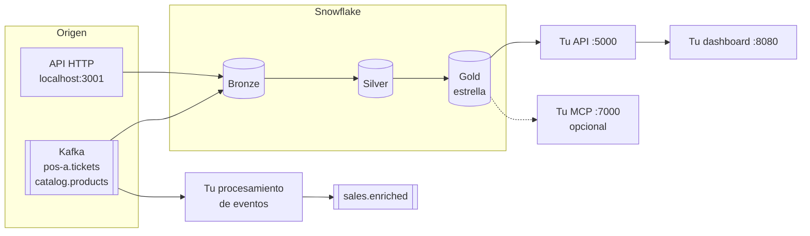

# Data Engineer Challenge: Retail Sales Lakehouse

Una cadena de moda con tiendas en varios países quiere analizar sus ventas en **Snowflake**, consultarlas desde una API y un dashboard, y tener sus eventos de venta enriquecidos en tiempo real. Te damos acceso a sus sistemas origen (simulados): unos publican por HTTP y otros en **Kafka**. El resto lo decides tú.



## Lo mínimo

1. Un **pipeline** que integre todos los datos del origen, HTTP y Kafka, en Snowflake con arquitectura **medallón** (bronze, silver y gold) y una capa gold modelada en **estrella**.
2. La vista **`GOLD.V_SALES_LINES`** sobre tu gold. Es lo que leeremos para comprobar los datos.
3. Un **procesamiento de eventos** que publique en el topic **`sales.enriched`** cada línea que llegue por Kafka, enriquecida, en menos de un minuto.
4. Una **API** en `:5000` que cumpla [`contracts/serving-api.yaml`](contracts/serving-api.yaml).
5. Un **dashboard** en `:8080` que consuma tu API.
6. Los comandos del **contrato de ejecución**, para que podamos ejecutarlo todo sin ti.

Es una prueba abierta. Con lo anterior funciona; lo que hagas por encima, y cómo lo justifiques, es lo que nos dirá tu nivel. No esperamos que lo cubras todo, pero sí que nos cuentes qué has dejado fuera.

Stack recomendado: Python en el pipeline, en el procesamiento de eventos y en la API, y React en el dashboard. Si otro te resulta más fácil (por ejemplo, Java con Spring Boot en la API), úsalo. Valoramos el diseño y la arquitectura del código, no solo que funcione.

## La vista que evaluamos

`GOLD.V_SALES_LINES` tiene una fila por línea de venta o de devolución. Puedes añadir columnas, pero no quitar ni renombrar estas:

| Columna | Qué es |
|---|---|
| `TICKET_ID`, `LINE_NO` | Ticket y número de línea en el origen |
| `LINE_TYPE` | `SALE` o `RETURN` |
| `BUSINESS_DATE` | Día de negocio: la fecha local de la tienda |
| `STORE_CODE`, `REGION` | La tienda y la región a la que pertenecía en el momento de la venta |
| `SKU`, `FAMILY`, `LIST_PRICE_EUR` | El producto, con la familia y el precio de tarifa que tenía en el momento de la venta |
| `CHANNEL` | `STORE` u `ONLINE` |
| `QUANTITY` | Unidades, en positivo |
| `NET_AMOUNT_LOCAL`, `CURRENCY` | Importe neto, sin impuestos, en la moneda de la tienda y en positivo |
| `NET_AMOUNT_EUR` | El mismo importe en euros, al tipo de cambio vigente en el día de negocio |

## El topic que publicas: `sales.enriched`

- **Un mensaje por línea** de venta o devolución que llegue por `pos-a.tickets`, con los mismos campos que la vista (en minúsculas) y el instante de la venta en `event_ts`. El formato está en [`contracts/sales-enriched.schema.json`](contracts/sales-enriched.schema.json).
- **Clave del mensaje:** `TICKET_ID-LINE_NO`. Si una línea cambia, publícala de nuevo con la misma clave: vale el último mensaje.
- **Latencia:** cada línea tiene que estar publicada menos de un minuto después de que llegue su evento.

## El sistema origen

`make source` levanta el origen y Kafka (Redpanda, compatible con Kafka).

**Por HTTP**, en `http://localhost:3001`, con su documentación en `/docs`. Todas las llamadas llevan la cabecera `X-API-Key: de-test-2026`.

**En Kafka**, dos topics en JSON:

| Topic | Qué publica |
|---|---|
| `pos-a.tickets` | Los tickets del TPV nuevo |
| `catalog.products` | Los cambios del catálogo de productos |

| Desde dónde te conectas | Bootstrap |
|---|---|
| Tu máquina | `localhost:19092` |
| Un servicio de este `docker-compose` | `redpanda:9092` |
| Un contenedor de otro `docker-compose` | `host.docker.internal:29092` |

El origen simula el paso del tiempo: solo publica lo ocurrido antes de su fecha actual (`GET /v1/clock`), tanto por HTTP como en Kafka. En local puedes moverla con `PUT /admin/clock`; en la evaluación la iremos avanzando día a día.

> **Evaluamos con otro dataset** servido por este mismo origen, con otras fechas y otros volúmenes. Tu código debe leer siempre de la API y de los topics, nunca de los ficheros de `source-system/data`, y no puede depender de fechas, tiendas ni productos concretos.

## Opcional: servidor MCP

Si quieres, expón tus datos a asistentes de IA con un servidor [MCP](https://modelcontextprotocol.io) en `http://localhost:7000/mcp` (transporte streamable HTTP). Lo comprobaremos llamando a estas herramientas, que devuelven el mismo JSON que su endpoint de la API:

| Herramienta | Parámetros | Equivale a |
|---|---|---|
| `get_daily_kpis` | `country`, `date_from`, `date_to` | `GET /v1/kpis/daily` |
| `get_store_kpis` | `store_code`, `date_from`, `date_to` | `GET /v1/stores/{store_code}/kpis` |
| `get_top_products` | `country`, `date_from`, `date_to`, `limit` | `GET /v1/products/top` |
| `get_freshness` | — | `GET /v1/meta/freshness` |

Puedes añadir las herramientas, recursos o prompts que quieras.

## Lo que te damos

| Carpeta | Qué es |
|---|---|
| `source-system/` | El sistema origen simulado, con datos de desarrollo |
| `contracts/` | El contrato de la API, la definición de la vista y el formato de `sales.enriched` |
| `platform/k6/` | El test de carga que lanzaremos contra tu API (`make load-test`) |
| `selfcheck/` | Comprueba que podemos leer tu vista, tu topic y tu API (`make selfcheck`). No comprueba si los datos son correctos |
| `setup/snowflake_setup.sql` | Prepara tu trial de Snowflake (créalo en Azure) con los mismos permisos que tendrás en la evaluación |

No modifiques estas carpetas: evaluamos con nuestras copias.

## Contrato de ejecución

Ejecutaremos estos comandos desde la raíz de tu repo, en una máquina con Docker, Python 3.12 y `make`. Si necesitas algo más (un JDK, Node...), encapsúlalo en Docker.

```bash
make deploy                       # crea o actualiza tus objetos en Snowflake (idempotente)
make stream                       # arranca tu procesamiento de eventos en segundo plano y devuelve el control
make backfill FROM=2026-10-01 TO=2026-10-20
make run-day DATE=2026-10-21      # integra lo publicado hasta DATE (incluido)
make test                         # tus tests
make api                          # levanta tu API en :5000 en segundo plano y devuelve el control
make web                          # levanta tu dashboard en :8080 en segundo plano
make mcp                          # (opcional) levanta tu servidor MCP en :7000 en segundo plano
make stop                         # para todo lo anterior
```

- **Conexión:** solo por variables de entorno (ver [`.env.example`](.env.example)), con autenticación por par de claves. La base de datos y el warehouse te llegan ya creados: `make deploy` crea dentro tus esquemas y objetos, y no puede requerir `ACCOUNTADMIN`.
- **Origen y Kafka:** en la evaluación los levantamos nosotros y te pasamos `SOURCE_BASE_URL` y `KAFKA_BOOTSTRAP_SERVERS`. Si algo tuyo corre dentro de un contenedor, usa `SOURCE_BASE_URL_DOCKER` y `KAFKA_BOOTSTRAP_SERVERS_DOCKER`.
- **Sin pasos manuales:** lo que no esté en el repo no existe para nosotros.

## Cómo evaluaremos

Desplegaremos tu repo en una cuenta nuestra y cargaremos el dataset de evaluación con `backfill` y `run-day`, día a día, mientras tu procesamiento de eventos está en marcha. Después comprobaremos los datos de la vista y del topic `sales.enriched`, probaremos la API (y el MCP, si lo has hecho) y leeremos tu código. Lo comentaremos contigo en una entrevista.

## Entrega

- **Formato:** un repositorio git con historial, con un enlace a un repo privado o con `git bundle create entrega.bundle --all`. Un zip sin `.git` no nos permite ver cómo has trabajado.
- **Secretos:** no subas `.env`, claves privadas ni credenciales.
- **README propio:** cómo se ejecuta, qué has decidido y por qué, qué has dejado fuera y qué harías con más tiempo.
- **Uso de IA:** puedes usar asistentes. En la entrevista te pediremos que nos expliques tu código.
